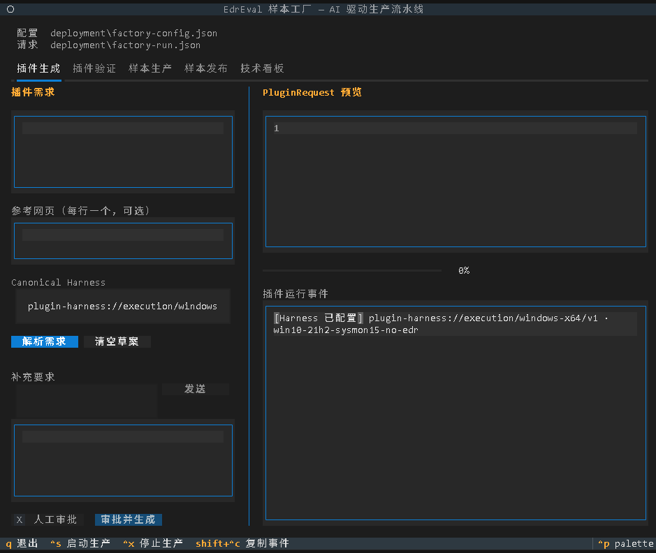
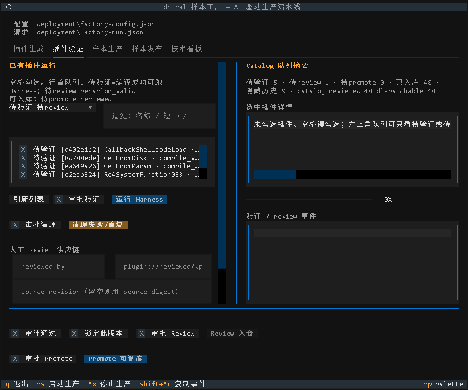
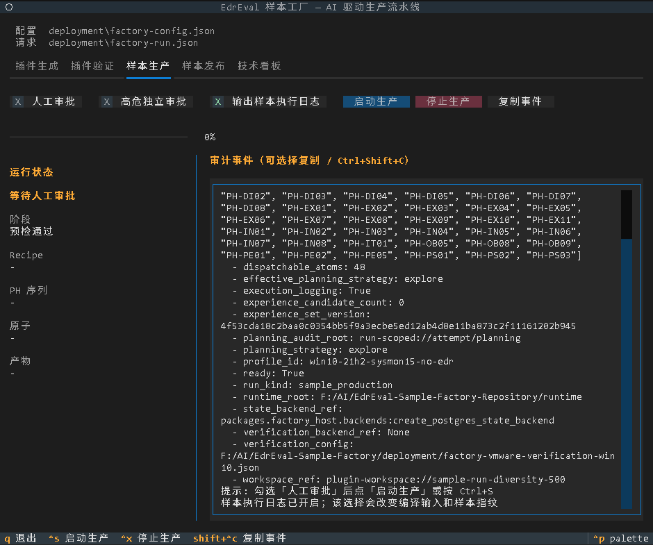
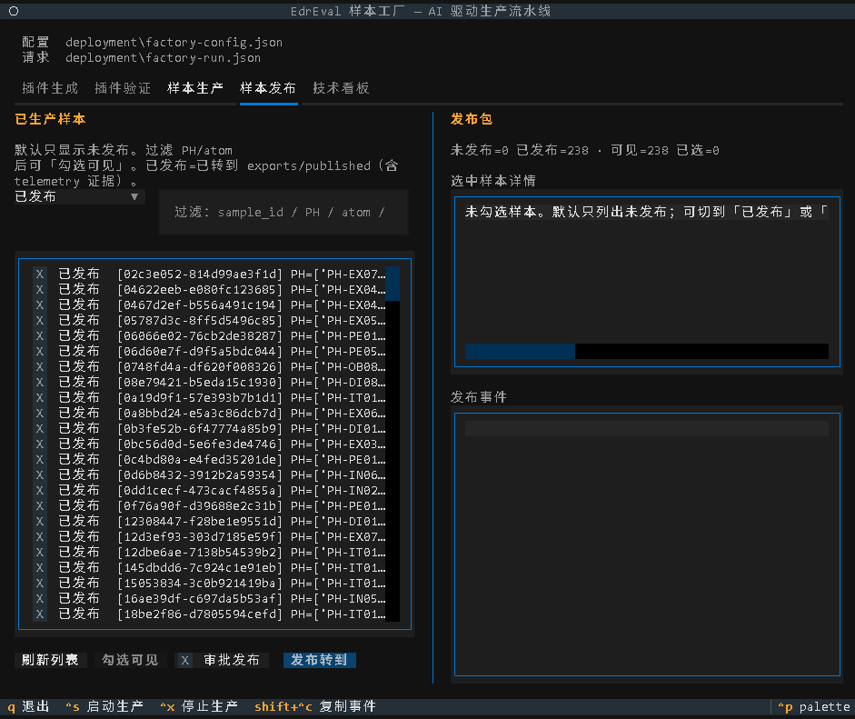
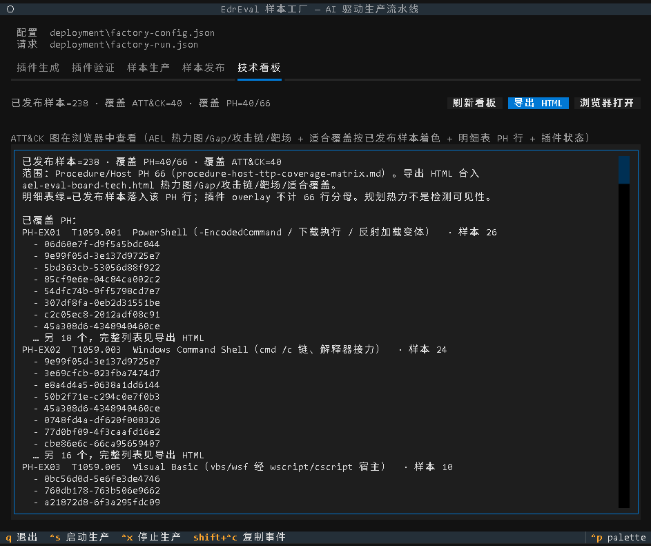

# EdrEval-Sample-Factory

### 面向 EDR / SOC BAS 的终端样本生成 Harness

EdrEval **Harness** 是一套离线控制面：把已登记的主机侧手法（Procedure / Host，简称 **PH**）固化为可复现终端样本，在隔离验证环境中执行，并用实验室传感器（如 Sysmon）证明手法**确实发生**。设计文档中的「流水线 A」即指本项目。

它回答的问题不是「能不能编出 EXE」，而是：

> 在约定环境与参数下，这条攻击手法链是否**可构建、可执行、可观测、可回归**？

出厂判定 `SUCCESS` 表示**功能真值**（行为按契约发生），**不是**商业 EDR「零检出」。


---

## Why Harness?

Harness 让你能够：

- **🧩 把手法碎片变成可调度样本。** 从插件成形到组合生产，统一走覆盖矩阵词汇表与 catalog 门禁，而不是一次性脚本拼装。
- **✅ 用功能真值闭环验收。** 在 VMware 验证机上执行，以 Sysmon 等实验室信号证明行为发生；`SUCCESS` ≠ 商业 EDR 漏检。
- **🖥️ 用同一套控制面操作。** **CLI** 适合脚本 / CI / 运维；**TUI** 适合日常联调（插件生成、验证、样本生产、发布、技术看板）。
- **🔐 把密钥与二进制挡在仓外。** 密钥只用 `secret://` / `lab-secret://`；插件源码与产物落在外部 Repository，控制面只持不透明引用。
- **📐 以 PH 行为组合主键。** `PH` = Procedure / Host（主机侧可复现步骤）；不以 ATT&CK T 编号去重（同一 T 号可对应多条落地路径）。

| 名称 | 含义 |
|---|---|
| **Harness**（本仓） | 终端样本生成系统（离线生产 + 功能真值验证） |
| **Plugin Harness** | 验证组件：单插件在 VMware 客户机上独立执行，并以 Sysmon 等信号做 oracle |

---

## Quick start

### 1. Prerequisites

- **Python 3.12+**（推荐用 [uv](https://docs.astral.sh/uv/) 管理解释器与虚拟环境）
- **LLM**：OpenAI 兼容 API（`runtime.toml` + `secrets.env`）
- **可选**：PostgreSQL（`combo_state` / 租约）
- **VMware 验证线（完整联调）**：Workstation + `vmrun`、基线快照、WinRM / 证书、guest profile

### 2. Install

```bash
# 推荐
uv venv --python 3.12 .venv
# Windows
.\.venv\Scripts\activate
# Linux / macOS
# source .venv/bin/activate

uv pip install -e .
# 需要 Postgres 状态后端时：
# uv pip install -e ".[postgres]"
```

入口等价：

```bash
python -m packages.sample_factory <command> ...
# 或
edreval-sample-factory <command> ...
```

### 3. Configure

两份核心 JSON：**部署配置**（`factory-config-v2`）与**单次运行请求**（`factory-run.json`）。模板在 `deployment/*.example`。

```bash
# 从模板复制并按本机改路径 / 密钥
copy deployment\factory-config.json.example deployment\factory-config.json
copy deployment\factory-run.json.example deployment\factory-run.json
copy deployment\runtime.example.toml deployment\runtime.toml
copy deployment\secrets.env.example deployment\secrets.env
```

| 配置 | 作用 |
|---|---|
| `factory-config.json` | catalog / runtime / 矩阵 / VMware / LLM / 后端引用 |
| `factory-run.json` | 候选 / 必选 PH、环境 profile、批次与 build target |
| `runtime.toml` + `secrets.env` | 模型与密钥（`secrets.env` **勿提交**） |
| `factory-vmware-verification*.json` | 组合样本验证（`vmrun`、快照、guest 口令引用） |
| `factory-plugin-harness*.json` | 单插件独立验证（角色、PH、oracle、隔离 profile） |

外部产物仓首次初始化：

```bash
python -m packages.sample_factory init-layout --root C:/path/to/EdrEval-Sample-Factory-Repository
```

```
catalog/          # Git 跟踪：plugins、build-targets、telemetry、experience…
runtime/          # 通常 gitignore：plugin-runs、runs、CAS store、exports…
```

### 4. Run

**预检（不生产）：**

```bash
python -m packages.sample_factory schema
python -m packages.sample_factory preflight ^
  --config deployment/factory-config.json ^
  --run deployment/factory-run.json
```

**CLI — 单插件成形（当前主路径）：**

```bash
python -m packages.sample_factory plugin-author ^
  --config deployment/factory-config.json ^
  --request deployment/plugin-seeds/requests/atom.ex.powershell.json ^
  --approve
```

**CLI — 组合样本生产：**

```bash
python -m packages.sample_factory produce ^
  --config deployment/factory-config.json ^
  --run deployment/factory-run.json ^
  --approve
# 高危另加：--approve-high-risk
```

**TUI — 交互界面：**

```bash
python -m packages.sample_factory tui ^
  --config deployment/factory-config.json ^
  --run deployment/factory-run-new-ttp.json
```

人工审批不得写入配置；生产 / 导出等须本轮现场确认（CLI 用 `--approve`，TUI 按界面流程）。

---

## Capabilities

Harness 将「手法碎片 → 可复现终端样本」收成两条主路径：

1. **单插件成形（Authoring）**  
   请求 / 种子 → 编码智能体成形 → 受控编译 → Plugin Harness（VMware）+ 遥测 oracle → `behavior_valid` → 人工 promote 入库  
2. **组合样本生产（produce）**  
   Planner 按 PH 词汇表选有序手法链 → Glue 填缝 → 编译终端样本 → 验证后端采集功能真值 → 发布到 CAS / catalog  

- **`PH` = Procedure / Host**：主机侧可复现步骤的稳定行 ID  
- **权威矩阵**：[`docs/coverage/procedure-host-ttp-coverage-matrix.md`](docs/coverage/procedure-host-ttp-coverage-matrix.md)（现行 66 行契约）

### CLI 与 TUI

| 界面 | 适用场景 | 入口 |
|---|---|---|
| **CLI** | 脚本化、CI、单次审批生产、运维（导出 / GC / 备份等） | `python -m packages.sample_factory <command> ...` |
| **TUI** | 交互：插件生成 / 验证、样本生产 / 发布、技术看板 | `python -m packages.sample_factory tui --config ... --run ...` |

二者共用同一控制面与配置；底层能力一致。

#### TUI 界面预览

**插件生成**



**插件验证**



**样本生产**



**样本发布**



**技术看板**



---

## Configuration reference

### `factory-config.json`（部署）

| 字段 | 含义 |
|---|---|
| `coverage_matrix` | PH 覆盖矩阵 Markdown（权威词汇表） |
| `catalog_root` / `runtime_root` / `manifest_root` | 外部产物仓目录（通常指向 `EdrEval-Sample-Factory-Repository`） |
| `verification_config` | 组合样本 VMware 验证配置 |
| `plugin_harness_config` | 单插件 Harness 配置 |
| `runtime_toml` / `secrets_env` | 模型与密钥 |
| `*_backend_ref` | 编译器、发布器、状态后端的可插拔工厂函数 |
| `planner_*` / `glue_*` / `compiler_*` | 重试、token、编译内存上限等 |

### `factory-run.json`（单次请求）

- `candidate_ph_ids` / `required_ph_ids`：规划候选与必选 PH 行  
- `profile`：验证环境指纹（OS / Sysmon / 快照等）；`no_edr_control` 表示功能真值环境  
- `batch`：一次请求可产多个不同组合  
- `build_target_ref` / `workspace_ref`：已登记编译目标与工作区引用  

仓库内 `factory-run-green-*.json` 等仅为本机联调参考，部署前须改成真实 profile / worker。

### Secrets

- `runtime.toml`：`provider` / `base_url` / `name` / `seed` 等  
- `secrets.env`：至少 `LLM_API_KEY`；Postgres 用 `FACTORY_POSTGRES_DSN` 或 `secret://…`，明文不进 JSON / Markdown  
- VMware 口令只写 `lab-secret://…` 引用  

### Ops commands（CLI 节选）

| 命令 | 作用 |
|---|---|
| `run-list` / `run-show` | 列出 / 查看 v2 运行包 |
| `run-reconcile` | 只读一致性检查 |
| `sample-list` / `sample-transfer` | 已 SUCCESS 样本与发布 |
| `artifact-verify` / `artifact-export` | CAS 校验与审批导出 |
| `bundle-export` | 多阶段 Bundle 原子导出 |
| `storage-report` / `gc-plan` / `gc-apply` | 容量统计与引用感知 GC |
| `experience-*` | 规划经验列表 / 检索 / 晋升 / 索引 |
| `metadata-backup` / `metadata-restore` | 元数据备份与恢复 |

生产副作用与运维副作用分离：导出、GC、备份等均为带审批的独立命令。

---

## Repository layout

| 路径 | 职责 |
|---|---|
| `EdrEval-Sample-Factory`（本仓） | **Harness 控制面**：规划、插件成形、胶水、验证适配、CLI / TUI、发布与门禁 |
| `EdrEval-Sample-Factory-Repository` | catalog / runtime / 插件源码与验证产物（二进制不进本仓） |

```
packages/sample_factory/   # 控制面（流水线、CLI、TUI）
packages/factory_host/     # VMware / Postgres 等宿主适配
packages/llm/              # OpenAI 兼容 LLM 客户端
packages/config/           # runtime.toml / secrets.env 加载
packages/schemas/          # 共享枚举与契约类型
packages/labmgr/           # 进程与资源护栏子集（编译限流）
deployment/                # 运行请求、Harness、插件种子模板
docs/                      # 设计合同、覆盖矩阵、实现讲解
img/                       # TUI 截图
scripts/                   # 验证机 bootstrap / guest runner
tests/                     # 控制面单测
```

控制面通过不透明引用访问产物（`plugin-workspace://`、`build-target://`、`artifact://`、`plugin-seed://`）。

---

## Safety boundaries

1. 密钥不进 Markdown / 日志；只用 `secret://`、`lab-secret://`。  
2. 载荷二进制不入库。  
3. 不虚构 ATT&CK / 检测可见性 / PH 行（未建行不得发明 `PH-*`）。  
4. Harness LLM 不得在线调度 / 投放；缺口通过审批后的工单流程补产。  
5. 人工审批不得写入配置；生产 / 导出须本轮现场 `--approve`；高危另加 `--approve-high-risk`。

---

## Development

```bash
python -m unittest discover -s tests -p "test_sample_factory*.py" -v
python -m unittest discover -s tests -p "test_factory_*.py" -v
python -m unittest tests.test_plugin_harness_oracles -v
```

---

## Documentation

| 文档 | 用途 |
|---|---|
| [`docs/coverage/procedure-host-ttp-coverage-matrix.md`](docs/coverage/procedure-host-ttp-coverage-matrix.md) | PH（Procedure / Host）行权威矩阵（入库） |
| [`AGENTS.md`](AGENTS.md) | 给自动化助手的硬边界摘要 |

运营合同 / 主机执行蓝本 / 实现讲解等长文位于本机 `docs/superpowers/`、`docs/dev/`（已 gitignore，不随仓发布）。冲突时：覆盖矩阵与本 README / `AGENTS.md` 为准；本机长文仅供本地研发。
